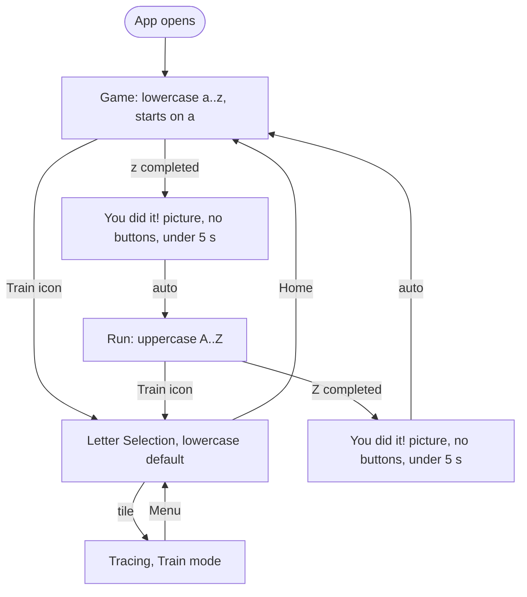

# Task 014 — Game opens on letter "a", guided alphabet run, Train icon button, lowercase default, fixed settings

**Status:** Draft (2026-10-26)
**Milestone:** PRD M3 refinement — navigation and game flow (play-testing feedback, round 2)
**Source feedback:** items 1, 2 and 4 of the 2026-10-26 feedback round
**Interacts with:** task 015 (letter audio plays when each letter appears in the run), task 016
(the header row freed by removing the Helplines toggle gives the trace surface more height)

## Feedback and human decision (2026-10-26)

Feedback:

1. Move to the next letter automatically.
2. Hard-bake certain features. Remove the choices children make today, such as Hard mode or
   showing guidelines.
3. Lowercase should be the default, not uppercase. Children see lowercase letters more often and
   need to master them.

Human decision, combining 1, 2 and 4 into this task:

- (Revised 2026-10-26.) There is **no Start button and no start menu**. The app opens directly on
  the tracing screen for the first lowercase letter, **"a"**, and the game begins immediately.
- **Train** is a **small, icon-only button in a top corner** of the game screen (no text; it needs a
  descriptive icon and an accessible name via `aria-label`). It opens today's start screen (Letter
  Selection) so a child can practise instead of playing the game. Letter Selection defaults to
  lowercase, not uppercase.
- The game screen shows **no other buttons**: no Next, no Menu/Home, no Helplines or other toggles.
  (Revised: the case toggle, Hard mode toggle and Helplines toggle all stay in Train mode.)
  The Train button is the only control on it.
- The game goes through all lowercase letters in order, then all uppercase letters in order.
- (Revised 2026-10-26.) Between the lowercase and uppercase letters there is no pause and no
  choice. A small **"You did it!" celebration screen** (a saved picture from this repo plus the
  text) shows **without any buttons** and goes away by itself within **5 seconds**, then the
  uppercase letters start automatically.
- The same celebration screen shows after the uppercase letters, then the game loops back to
  lowercase `a`.
- Because there is no Exit, the **game summary page is removed** from this task.
- The next letter shows only after the current letter is completed. It appears automatically
  **5–10 seconds** later, after the completed letter has been shown.

## Current behavior (verified in code, 2026-10-26)

| Concern                 | Where                                                                                                                                    | Value / behavior                                                                                                                                                                                                                                                                   |
| ----------------------- | ---------------------------------------------------------------------------------------------------------------------------------------- | ---------------------------------------------------------------------------------------------------------------------------------------------------------------------------------------------------------------------------------------------------------------------------------- |
| App entry               | [src/App.tsx](../../../src/App.tsx)                                                                                                      | `currentScreen` starts at `"menu"`, which is Letter Selection. There is no start menu.                                                                                                                                                                                             |
| Default case            | `App.tsx` `selectedCase`                                                                                                                 | `"uppercase"`                                                                                                                                                                                                                                                                      |
| Hard mode               | `App.tsx` `isHardMode`, [LetterSelectionScreen.tsx](../../../src/modules/letter-nav/LetterSelectionScreen.tsx)                           | Toggle on Letter Selection, off by default. It drives the 2 s shadow-only preview in [LetterTracer.tsx](../../../src/modules/tracing/LetterTracer.tsx).                                                                                                                            |
| Helplines               | [TracingScreen.tsx](../../../src/modules/tracing/TracingScreen.tsx), [TracingHeader.tsx](../../../src/modules/tracing/TracingHeader.tsx) | Toggle in its own header row, off by default on every letter.                                                                                                                                                                                                                      |
| Next letter             | `TracingHeader` `next-letter`                                                                                                            | Manual only, and it wraps from z to a. The child can skip a letter without finishing it.                                                                                                                                                                                           |
| After letter completion | `LetterTracer` `onCelebrationDone`                                                                                                       | After 0.5 s the celebration plays for 1.5 s, then `reset()` **clears the letter back to segment 1**. The finished letter does not stay on screen. This already differs from the UISPEC Tracing transition "`letter-complete` → celebration ends → remain on the completed letter". |
| Session progress        | —                                                                                                                                        | None. Nothing records which letters were completed in this session.                                                                                                                                                                                                                |
| Pictures in the repo    | —                                                                                                                                        | The only image is [cms/icons/english.png](../../../cms/icons/english.png), the CMS language icon (a traced "A"). **There is no celebration picture yet.**                                                                                                                          |
| Reporting               | [reporting.ts](../../../src/modules/container/reporting.ts)                                                                              | `reportLetterCompleted(letter, isHardMode)` sends `hard_mode` with every `letter_completed` event.                                                                                                                                                                                 |

## Spec conflicts (the human decision overrides these; the spec-update pass must supersede them)

- **C1 — App entry and case default.** PRD §3 Goals and §6 M3 ("app opens on letter selection",
  "case defaults to uppercase"), PRD Resolved Decision 2026-10-01, DEVSPEC §3 Letter Navigation
  tasks 2–3, DEVSPEC §2 `AppNavigationState.selectedCase` ("uppercase by default"), DEVSPEC
  Resolved Decision 2026-10-01, and UISPEC §1 Screen Inventory and the "Case selection (M3)"
  Gherkin.
- **C2 — Hard mode toggle hidden from the game.** (Revised.) The toggle stays in Train only. The game
  run is always easy mode. Affects PRD §3 Goals, PRD M3, DEVSPEC §3 Letter Navigation task 4,
  DEVSPEC §2 `AppNavigationState.isHardMode`, and the UISPEC "Hard mode preview mode selection
  (M3)" Gherkin, which must now say "in Train". TESTSPEC T-022, T-023, T-025 and T-033 stay valid
  for Train; only the Letter Selection entry path changes.
- **C3 — Helplines toggle hidden from the game.** (Revised.) The toggle stays in Train only. The game
  run always shows helplines (Q1). Affects DEVSPEC §3 Tracing Helplines tasks 1 and 6, PRD Resolved
  Decision 2026-09-23, the UISPEC "Tracing helplines" Gherkin, and TESTSPEC T-026 and T-028, which
  stay valid for Train.
- **C4 — No manual Next during the run.** DEVSPEC §3 Letter Navigation task 5(b), the UISPEC
  "Top-bar navigation (M3)" Gherkin, and TESTSPEC T-021, which stay valid for Train only.
- **C5 — Rewards beyond the per-letter celebration.** PRD §4 Non-Goals lists "rewards beyond the
  per-letter celebration animation". The short round-complete celebration screen is new, but it is
  session-only. Nothing is persisted, so the persistence non-goal is not affected.
- **C6 — Completed letter stays on screen.** This makes the code match the existing UISPEC
  transition. It is not a new conflict, but the change in behavior must be noted.

## Open questions (recommendations in **bold**; answer before moving to `active/`)

| #   | Question                                                                                 | Options                                                                                                                                                  | Recommendation                                                                                                                                                                                     |
| --- | ---------------------------------------------------------------------------------------- | -------------------------------------------------------------------------------------------------------------------------------------------------------- | -------------------------------------------------------------------------------------------------------------------------------------------------------------------------------------------------- |
| Q1  | (Revised) Helplines in the game run: always **on** or **off**? (Train keeps its toggle.) | On / Off                                                                                                                                                 | **Always on in the game.** They show where lowercase letters sit (x-height, baseline, descender). They never affect scoring.                                                                       |
| Q2  | (Revised) Hard mode is hidden in the game but kept in Train. How?                        | (a) `isHardMode` app state and the Letter Selection toggle stay. The game run passes `false`. (b) Remove hard mode entirely.                             | **(a).** No code is removed. `hard_mode` in events is `true` only for Train letters traced in hard mode.                                                                                           |
| Q3  | Does **Train** also auto-advance?                                                        | (a) Yes, same delay, wraps within the selected case, and Next stays available. (b) No. Train stays on the finished letter until Next or Menu is pressed. | **(a).** Feedback item 1 was general, and one rule is easier for children to learn.                                                                                                                |
| Q4  | Exact auto-advance delay (the range given was 5–10 s)?                                   | Any value from 5,000 to 10,000 ms                                                                                                                        | **6,000 ms from `letter-complete`.** The celebration ends at about 2 s, so the finished letter then shows for about 4 s. Make it one constant, `AUTO_ADVANCE_DELAY_MS`, and tune it on the device. |
| Q5  | What does "after the complete letter has shown itself" mean?                             | (a) The finished, all-green letter stays on screen until the auto-advance. (b) A replay animation draws the whole letter.                                | **(a).** It needs no new animation and fixes C6.                                                                                                                                                   |
| Q6  | Which picture goes on the celebration page?                                              | The human adds a file. It must be PNG, JPEG, WebP or SVG in its **true** format (third-party spec §4), and ideally under 200 KB.                         | **Add it as `src/assets/round-complete.<ext>` and import it.** Vite then bundles it into the engine ZIP with a relative URL that works on `file://`. **Blocking:** it does not exist yet.          |
| Q7  | (Revised) What happens after the uppercase round?                                        | (a) Celebration, then loop back to lowercase a. (b) Celebration, then stay on the last letter.                                                           | **(a).** There are no buttons to choose with, so the game just keeps going.                                                                                                                        |
| Q8  | (Removed) Summary page                                                                   | —                                                                                                                                                        | Dropped. Its only entry points were Exit and the 30 s timeout, which no longer exist.                                                                                                              |
| Q9  | (Revised) What does the icon Train button do during the game?                            | (a) Opens Train (Letter Selection) and drops the run. (b) Pauses the run and returns to it afterwards.                                                   | **(a).** Simplest. Letter Selection's Home button restarts the game at lowercase `a`. There is no other way out of the game screen.                                                                |
| Q10 | (Revised) How long does the celebration show?                                            | Any value up to 5,000 ms                                                                                                                                 | **3,000 ms**, as one constant `ROUND_COMPLETE_DISPLAY_MS` (must stay ≤ 5,000). No ring, no text other than "You did it!". Reduced-motion users get no animation.                                   |

## Scope

### Flow

The RC2 → RL edge follows Q7 (a), and the Train edges follow Q9 (a).

### 1. App entry (no start menu)

- There is no Start button and no start menu. The app opens on Tracing in Run mode at lowercase
  `a`, segment 1. The TraceQuest title is not required on this screen.
- **Train button:** small (but at least 44 px touch target), in a top corner of the game screen,
  **icon only, no visible text**. Use a descriptive inline SVG, e.g. a pencil over a dotted
  letter/practice grid, with `aria-label="Train"` and `data-testid="train-button"`. It does not
  overlap the trace surface.
- The game screen has **no other buttons**: no Next, no Menu/Home, no Helplines toggle.

### 2. Train = Letter Selection

- Letter Selection opens from the Train icon button. It keeps **all of its current controls**: the
  uppercase/lowercase case toggle (now **defaulting to lowercase**) and the **Hard mode toggle**.
  The case and Hard mode choices last for the session only, as before.
- Picking a tile opens Tracing in **Train mode**, with Menu (back to Letter Selection), Next and the
  **Helplines toggle** exactly as today (off by default per letter). Auto-advance follows Q3.
  (These controls belong to Train only, not to the game.)
- A way back to the game from Letter Selection: a top-left "Home" button that restarts the game at
  lowercase `a`.

### 3. Game run (Tracing in Run mode)

- The run goes through `content.lowercase` in order, then `content.uppercase` in order. It uses the
  language pack's order, so other languages work without code changes.
- There is **no Next button and no Menu/Home button**. A letter can only be left by completing it,
  or with the Train icon button (Q9).
- On `letter-complete`, the celebration plays as today. The finished letter **stays drawn**: no
  `reset()` in Run mode, and also none in Train if Q3 = (a). After `AUTO_ADVANCE_DELAY_MS` the next
  letter opens at segment 1.
- After the last letter of a case, the round-complete celebration shows instead of the next letter.

### 4. Round complete celebration (no buttons)

- It shows the picture (Q6) and "You did it!". It has **no buttons at all**.
- After `ROUND_COMPLETE_DISPLAY_MS` (Q10, at most 5,000 ms) it closes by itself. After lowercase the
  game continues with uppercase `A`; after uppercase it follows Q7. The timer is cleared if the
  screen unmounts (e.g. nothing else is reachable, but keep the cleanup).

### 5. Settings: fixed in the game, adjustable in Train

- **Game run:** easy mode (persistent shadow) and helplines always on. No toggles are shown.
- **Train:** case toggle, Hard mode toggle and Helplines toggle all remain, as today.
- Reporting keeps the `hard_mode` field: `false` in the game, the real value in Train. The
  `letter_completed` and `summary_data` events are unchanged.

## What "done" looks like

This traces to [PRD](../../specs/PRD.md) v0.9.0, [DEVSPEC](../../specs/DEVSPEC.md) v0.12.0,
[UISPEC](../../specs/UISPEC.md) v0.10.0 and [TESTSPEC](../../specs/TESTSPEC.md) v0.11.0:

- **DEVSPEC §3 Letter Navigation:** the app opens directly on lowercase `a` in the game run, which
  runs lowercase, then uppercase, with auto-advance only after `letter-complete`. The icon-only
  Train button opens Letter Selection with lowercase as the default. T-011, T-012, T-021, T-031 and
  T-032 are updated to go through Train, and T-031 now expects lowercase by default.
- **DEVSPEC §3 Celebration Animation:** in Run mode, and in Train if Q3 = (a), the finished letter
  stays drawn after the celebration until the auto-advance. T-013 and T-014 still pass.
- **DEVSPEC §3 Tracing Helplines:** the toggle remains in Train. The game run always shows
  helplines (Q1). T-026, T-027 and T-028 stay valid for Train.
- **Hard mode:** the toggle remains on Letter Selection (Train). The game run is always easy mode.
  T-022, T-023, T-025 and T-033 stay valid, reached through Train.
- New TESTSPEC cases are proposed for the spec-update pass. The final IDs are assigned in merge
  order.
  - **T-041:** the Train button has no visible text, has `aria-label="Train"`, and opens Letter
    Selection with `case-toggle` set to lowercase and the Hard mode toggle still present. There is
    no `start-button`.
  - **T-042:** on launch the app shows lowercase `a` at segment 1. The only button on the screen is
    `train-button`: no `next-letter`, no menu/home button, no helplines toggle.
  - **T-043:** with fake timers, the run does not advance before `letter-complete`. After
    completion the letter stays drawn, and `b` opens exactly at `AUTO_ADVANCE_DELAY_MS`.
  - **T-044:** completing `z` shows the round-complete screen with the picture and "You did it!"
    and no buttons. With fake timers, uppercase `A` opens at `ROUND_COMPLETE_DISPLAY_MS` (≤ 5 s).
  - **T-045:** completing `Z` shows the celebration again, then lowercase `a` opens (Q7).
  - **T-046:** the Train button during a run opens Letter Selection and drops the run (Q9). Home on
    Letter Selection restarts the game at `a`.
- A UISPEC update is proposed: the game screen as app entry (with the icon-only Train button),
  a new button-less "Round Complete" screen in §1 and §2, Gherkin for each flow above, and new
  test IDs `train-button`, `round-complete-screen` and `home-button`.
- `npm run check` passes.
- The AI checks the full flow in the integrated browser at a 360×740 phone viewport and a
  768×1024 tablet viewport. It completes letters with scripted pointer events in one Playwright
  script, because the page state can change between calls.

## Out of scope

- Letter audio (task 015).
- Bigger letters, screen layout, dots, and stroke order (task 016). The only layout change here is
  removing the Helplines row from the game run (it stays in Train).
- Persisting progress across reloads, stars or mastery.
- A `session_complete` container event. It is only proposed in
  [standalone-game-spec-data.md](../../standalone-game-spec-data.md) and not confirmed with the
  data team.
- Translating UI strings ("You did it!", button labels). They stay hard-coded in English like the
  existing UI.

## Implementation steps

1. **Constants** ([constants.ts](../../../src/shared/constants.ts)): add `AUTO_ADVANCE_DELAY_MS`
   (Q4) and `ROUND_COMPLETE_DISPLAY_MS = 3000` (Q10, at most 5000).
2. **Asset:** the human adds the picture (Q6). The AI imports it from `src/assets/`.
3. **New module `src/modules/game-flow/`:**
   - `TrainButton.tsx` (icon-only, inline SVG, `aria-label`), and a button-less
     `RoundCompleteScreen.tsx` that closes itself after `ROUND_COMPLETE_DISPLAY_MS`.
   - A small `useGameRun` hook, or plain state in `App.tsx` if it stays short. It holds the current
     case and the letter index.
4. **[App.tsx](../../../src/App.tsx):**
   - Screens become `"tracing" | "train-select" | "round-complete"`, and the initial
     screen is `"tracing"` in Run mode at lowercase `a`.
   - Add `mode: "run" | "train"`.
   - `selectedCase` defaults to `"lowercase"`.
   - Keep `isHardMode` and its handler for Train. The game run always passes `false`.
5. **[LetterSelectionScreen.tsx](../../../src/modules/letter-nav/LetterSelectionScreen.tsx):**
   keep the case and Hard mode toggles, and add a Home button.
6. **[TracingScreen.tsx](../../../src/modules/tracing/TracingScreen.tsx) and
   [TracingHeader.tsx](../../../src/modules/tracing/TracingHeader.tsx):**
   - Add a `mode` prop.
   - In Run mode the parent controls the letter index: an `onLetterComplete` callback, Next and
     Menu are hidden, and only the icon-only Train button is shown in a top corner.
   - In Train mode the header keeps Menu, Next and the Helplines toggle row as today.
   - In Run mode the Helplines toggle row is not rendered and `showHelplines` is constant `true`
     (Q1).
7. **[LetterTracer.tsx](../../../src/modules/tracing/LetterTracer.tsx):**
   - Add an `onLetterComplete` prop.
   - After the celebration, keep the completed letter instead of calling `reset()` (Q5).
   - Start the auto-advance timer from `letter-complete` and clear it on unmount.
8. **Reporting:** pass `false` for `hard_mode` in Run mode and the real value in Train. No other
   change.
9. **Tests:** update `App.navigation.test.tsx`, the `LetterSelectionScreen` tests and the tracing
   integration tests as listed in "done", and add T-041 to T-046 using `vi.useFakeTimers()`.
10. Run `npm run check`, then the browser checks.
11. Rebuild the CMS packages (`npm run package:cms`). Only the core ZIP changes. Do not upload; the
    human does that.
12. Write the real-device checklist below into the task file with the results, and add durable
    lessons to `.agents/memory/lessons.md`.

## Real-device checklist (human)

1. The app opens directly on `a`. The only button is a small icon in the top corner, and it is
   understandable without text and hard to hit by accident.
2. There is no Next or Menu button. The finished letter stays visible and `b` appears by
   itself after the agreed delay, which does not feel too slow or too fast.
3. After `z`: the picture and "You did it!" appear with no buttons, vanish within 5 s, and `A`
   opens by itself. After `Z` the game loops to `a`.
4. The Train icon opens lowercase tiles. The case toggle still switches to uppercase, and the Hard
   mode toggle is there. Home on that screen restarts the game at `a`.
5. In Train tracing, the Helplines toggle, Next and Menu work as before. In the game there are no
   toggles, and helplines are always visible.
